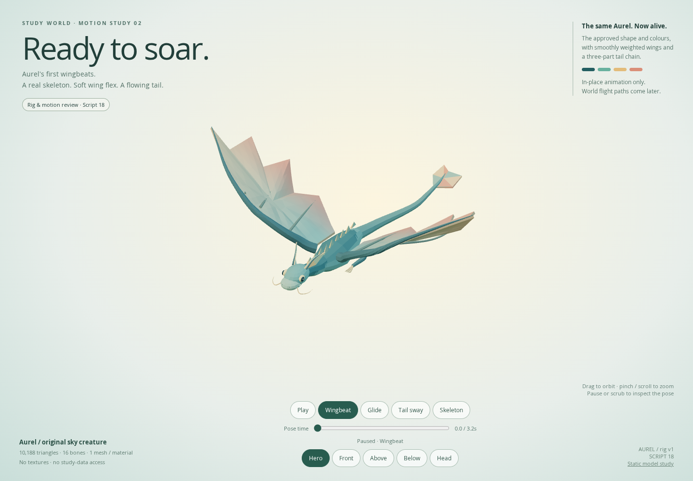

# Script 18 — Aurel's first wingbeats

> **Website update:** Aurel now flies in the live planner. No Blender steps are required to use it. See [flight integration](FLIGHT.md). The script instructions below remain optional source/editing workflows.

The user approved the Script 17 model in Blender and authorized rigging/animation. This step adds a **real 16-bone armature, smooth skin weights and three in-place loops**, preserving every approved bind-pose vertex and colour. **It does not add flight paths to the planner.**



**[Watch the actual 3D motion recording](aurel-flight-motion.webm)** — Wingbeat → Glide → TailSway. This is a recording of the skinned WebGL canvas, not an AI-generated video or a camera-only effect.

## Download and run this one file

**[18_aurel_flight_animation.py](../../assets/blender/scripts/18_aurel_flight_animation.py)** — complete, standalone, offline. No Script 17, .blend, external model, add-on or path editing is needed.

1. Download it to:

   `C:\Users\kashif\Desktop\3d-world-study-planner\blender\scripts\18_aurel_flight_animation.py`

2. In Blender, choose **Scripting → Text → Open**, open that file, then click **Run Script**.
3. Switch to **Layout**. With the pointer over the 3D viewport or Timeline, press **Spacebar**. Aurel should flap its wings and gently sway its tail. Press Spacebar again to pause.
4. To try another loop, put the pointer over the 3D viewport, press **N** to open the sidebar, choose **Aurel → Motion**, then select **Glide** or **Tail sway**. The script updates the frame range and returns to frame 1 automatically. Press Spacebar to play if paused.
5. Manually choose **File → Save As**:

   `C:\Users\kashif\Desktop\3d-world-study-planner\blender\source\study_world_aurel_animated_v1.blend`

   **Choose a fresh name if this already exists.** Script 18 creates a NEW scene on every run. It never saves, exports, downloads or deletes anything. Your previous scenes, Script 17 and static model remain intact.

**Expected scene:** `Study World - Aurel Animated v1` (possibly a numbered suffix after repeated runs). Collection `SW18_Aurel_Rig_EXPORT` contains the armature and weighted creature; `SW18_Presentation_DO_NOT_EXPORT` contains camera/lights. The selected armature drives one mesh. Playing an animation moves the creature **in place**; it will not travel around islands yet.

### Three loops

| Motion | Length | Blender frames at 30 fps | Purpose |
| --- | --- | --- | --- |
| Wingbeat | 3.2 s | 1–96 | Mirrored shoulder motion, delayed elbow/wrist flex, small body bob, stabilized head and flowing tail |
| Glide | 6 s | 1–180 | Quiet open wings with restrained flex and slower tail movement |
| TailSway | 4.8 s | 1–144 | Tail-chain/rudder inspection with stationary wings and body |

The actions include a repeated endpoint key just beyond the playback range. The script excludes that duplicate frame from playback to avoid a one-frame hold at each loop boundary; the GLB mixer wraps by time. These are cyclic in-place studies, not physics-driven flight. The tail fin and head fins are retained from the approved design.

### Saving/reopening and the sidebar

The **Aurel** sidebar is a convenience registered for the current Blender session, **not an installed add-on**. It may be absent after restarting Blender. The saved rig, weights and actions still work: the currently selected action plays normally. To switch loops after reopening without rerunning the script, select `SW18_Aurel_Armature`, change a Dope Sheet area to **Action Editor**, select the saved `SW18_Aurel_Wingbeat`, `SW18_Aurel_Glide` or `SW18_Aurel_TailSway` action (possibly with a numeric suffix), and use the frame range above. Do not enable automatic script execution just to obtain the sidebar.

If Blender reports an error, send its **full message and line number**. Python/data/math checks passed, but **actual Blender 5.2 application execution remains unverified here**. Browser skinning and Blender rendering/interpolation can differ slightly between sampled keys.

## Embedded 3D review

The **Aurel — animated 3D review** live preview on **5176** now opens the motion studio. The normal planner remains on **5173**. No external-tab workaround is required.

- **Wingbeat / Glide / Tail sway**, **Play/Pause**, pose-time slider, real skeleton toggle.
- **Hero / Front / Above / Below / Head** views; drag to orbit and scroll/pinch for bounded zoom.
- Reduced motion on first load or changed live stops automatic motion and disables play overrides. Discrete pose scrubbing still works.
- Hidden-document and non-intersecting-canvas guards stop the timer; returning resumes without wall-clock catch-up. A maximum ~30 Hz timeout schedule is a ceiling, **not measured hardware FPS**.
- The original static study remains at `/design/sky-creature/review.html` and via the desktop studio link. Its script, GLB, reviewer and PNG are unchanged.

The rigged GLB is development-only under `design/sky-creature/models`, **not in deployed app models**. No planner component imports it, no learning state is read/written, and production `npm run build` does not ship the art studio. Runtime flight routes, counts, safe screen regions, optional-loading isolation and app-specific reduced-motion policy require a later authorized integration step.

## Asset and rig details

- `models/aurel_sky_drake_rigged_v1.glb`: **1,688,464 bytes**, **10,188 triangles**, **one skinned mesh / one shared opaque vertex-colour material / one creature draw call** (skeleton overlay adds a separate line draw).
- **16 bones:** Root, Body, Neck, Head; TailBase/Mid/Tip + Rudder; left/right Shoulder/Elbow/Wrist + folded Leg. Uniform rest bases make Blender/Three coordinate conversion explicit and testable. This is a direct FK deformation rig, not an IK/control-rig add-on.
- **10,137 indexed vertices** have blended weights. Up to two nonzero influences per vertex, normalized into four GLB channels. Smooth span-wise wing and length-wise tail/neck weighting prevents rigid-card movement; corresponding wing seam positions use identical weights.
- Same 13 semantic part ranges retained in the merged mesh recipe. Blender exposes a face-domain `Aurel_Part` attribute and a `part_names` custom property for later editing. Batching changes draw organization, not the approved geometry/colours.
- Source: `scripts/art/sky-drake-rig.mjs`, importing the unchanged `sky-drake.mjs`. Builder: `scripts/build-sky-animation.mjs`. Hash and clip durations: `animation-manifest.json`.

## Verified results and reproduction

```sh
npm ci
npm --prefix design/model-review ci
npm run art:sky-animation
npm run test:sky-animation-assets
npm run sky:review
# Keep the review server running; use another terminal:
npm run test:sky-animation
npm run build
npm test
```

- **13 new browser check groups passed:** actual skinned draw counts, distinct up/downstroke geometry, three clip selectors, play/pause/scrub, true bone links, camera/orbit/zoom, 320/390/430px controls, live and first-load reduced motion, simulated document-hidden signal, actual non-intersecting canvas pause/resume, original static reviewer availability, WebGL motion recording, no storage writes and zero browser page/console errors.
- Actual GLB finite geometry/colours/skin weights, 16-bone hierarchy, every indexed source position/colour/weight, all embedded animation times/values and smooth periodic quaternion endpoints verified. Sampled all three genuinely deforming loops and bounded poses. An independent Blender-basis skinning calculation matches transformed Three CPU skinning; **this is mathematical/data validation, not a Blender runtime test**.
- Complete Python compilation, embedded source recipe equality, slotted-action/linear-keyframe construction and offline/new-scene/no-save/export/delete safety checks passed. The only `bpy.ops` call is changing object mode for armature editing. **64 prior asset/script/static-review files hash-preserved**.
- Strict TypeScript/production build and **112 existing unit tests passed anew**. Static Script 17 asset/safety checks also passed again. Prior 84 planner browser groups are **historical villager-stage results**, not fresh app regression claims for this isolated art stage. No phone FPS, Safari/Firefox, actual Blender runtime or app flight-performance claim.

QA JSON and extra pose/mobile screenshots live in ignored `.cache/sky-animation/`; durable preview files are `animated-preview.png` and `aurel-flight-motion.webm`. No commits/pushes or backend/schema/parser/scheduling changes were made.
