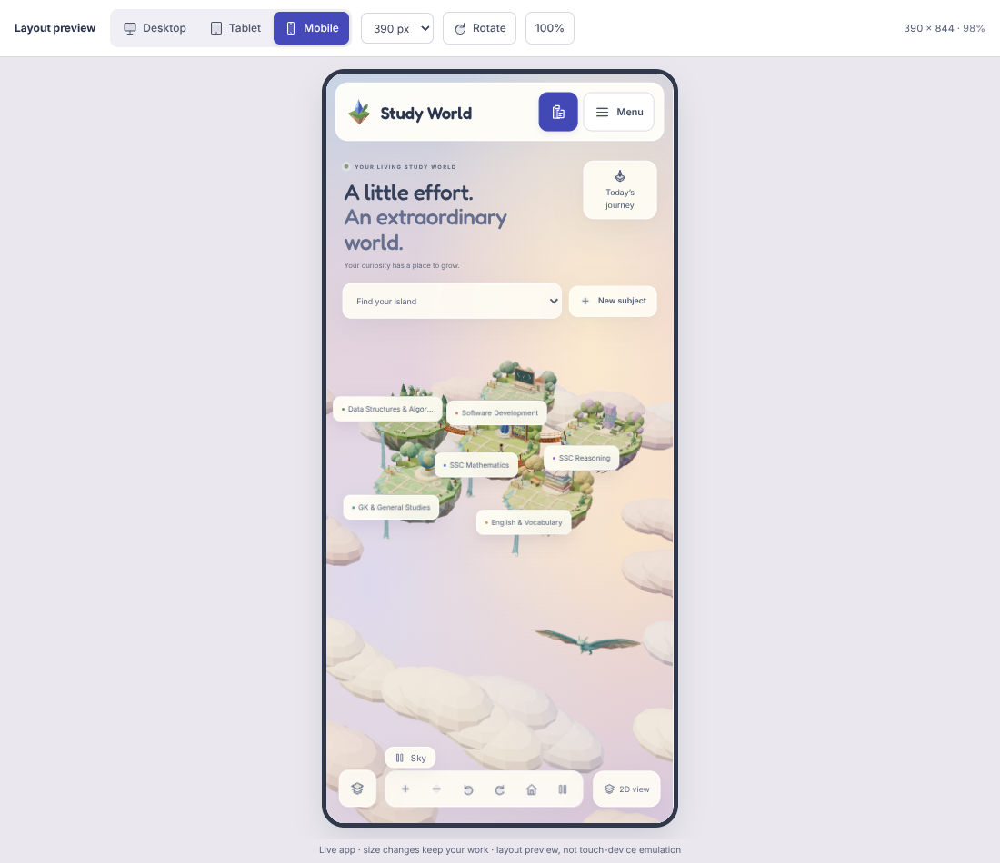

# Aurel is live in the planner

The user authorized direct website integration. **No Blender work is required.** The approved, genuinely skinned Script 18 GLB now flies inside the real Three/R3F scene on **5173**. The separate motion studio on 5176 and Scripts 17–18 remain available for optional editing/review.



The default mobile visibility correction excludes the unpainted contents of the closed Island atlas from clearance. Aurel is larger, flies lower in compact overviews, and stays in front of the distant cloud bank. The screenshot above is from the actual embedded app, not the model studio.

## What changes for the user

- **One creature maximum per world canvas**, on desktop and mobile. No crowd of flyers.
- A slow 48-second, view-aware sky circuit with depth variation and gentle banking. Wingbeat/Glide clips blend over three seconds, retaining their own smooth wing/tail animation.
- A small **Sky** pause/resume button, separate from the original six camera/villager controls. It freezes both travel and wing animation. The pause is per mounted scene, not a stored study preference.
- Reduced-motion settings disable automatic flight and use a static Glide pose. The button cannot override the OS preference. Orbit, zoom, topic selection and all study tools still work.
- Hidden document or offscreen canvas stops both clocks. Resume does not accumulate elapsed background time. A decorative-download failure hides only Aurel and disables its control, not the islands, villagers or planner.

The creature does not count as study progress, respond to grades, earn rewards, alter topics or write to storage. No parser, scheduling, exam or backup schema changes.

## Placement and input safety

This is a **view-aware 3D route**, not a physical simulation of a creature circling a particular island. Its sky band adapts to camera framing so it remains readable while the user explores through 360°. The actual 3D mesh follows the path in perspective, points along the 3D tangent and banks; it is not an image, CSS sprite or billboard.

Desktop and tablet now reserve a **whole swept flight corridor** before placing the route, leaving room for the complete wing movement throughout the loop. The corridor is chosen from painted UI and all projected topic regions, not this frame’s wing pose. Desktop prefers upper sky; tablet can use lower sky when its two-row header crowds the top. Horizontal travel and, if necessary, creature size are fitted to the clear corridor. Compact focused gardens use the open band above the island. Compact overviews use open **lower sky** because the header/journey/subject controls consume the top of the small display. Route depth and world scale follow the current camera/subject framing; the footprint is capped rather than growing when zooming into a topic.

Conservative per-bone bind-space boxes are transformed and projected using the current wing pose each frame. Normalized skin weights keep the animated mesh inside their combined screen footprint, without the excessive empty space of a whole-body cube. Only actually painted UI is protected: closed-details contents, CSS-hidden overlays and empty rectangles do not reserve fictional sky areas. It is checked against all six actual topic-footprint regions on each visible island and cached screen rectangles for topic/island labels, panels, header/notices, dialogs, paging and controls. Aurel is temporarily hidden where these areas would overlap or clip at an edge. Its meshes have **no raycast hit targets**, cast no shadows and receive no shadows. It cannot intercept a plot click or trigger selection/hover. UI remains above the canvas as before.

The route clock continues through brief visual-clearance gaps so it can return naturally; the small skeleton also advances while concealed so its clearance footprint cannot become stuck in an old wing pose. Outside the whole canvas viewport or in a hidden tab, both stop. UI rectangle measurements are refreshed about every 160 ms and on relevant framing changes, not layout-read on every frame; projected plot safety is checked every frame.

## Budget and resource lifetime

- Approved GLB: **1,688,464 bytes**, 10,188 triangles, **one skinned mesh / one opaque vertex-colour material / 16 bones**; no textures/external resources.
- Single independent fetch/parse cache and optional-art error boundary. SkeletonUtils clones the small rig; geometry/materials remain shared. Only instance bone textures and mixer bindings are released on real unmount.
- StrictMode cleanup is cancellable through a live WeakSet/microtask, preserving reusable animation bindings during effect replay.
- R3F retains `frameloop="demand"`. One sky-layer demand timeout schedules at most **24 Hz desktop / 18 Hz compact**, slowing its requests to 8 Hz while concealed. These are scheduling ceilings, **not measured FPS** or a global cap across other layers' invalidations. Existing villagers retain their own scheduler. No dynamic shadow-map invalidation for flight.
- Sky pause is separate to avoid making the existing six-button mobile camera/villager row smaller. Group-paged worlds shift the Sky control away from Previous/Next; compact placement leaves the task panel and paging usable.

## Files and reproduction

- Runtime: `src/components/SkyCreature.tsx`.
- Path/budget helpers: `src/domain/sky-flight.ts`, `sky-flight.test.ts`. Painted-overlay and animated-footprint helpers: `src/domain/sky-bounds.ts`, `sky-bounds.test.ts` (13 tests). Whole-route corridor planning and four regression tests: `src/domain/sky-corridor.ts`, `sky-corridor.test.ts`.
- World mounting and independent Sky control: `src/components/WorldScene.tsx`, `src/styles.css`.
- Published model and metadata: `public/models/aurel_sky_drake_rigged_v1.glb`, `aurel-flight-v1.json`.
- `npm run art:sky-flight` republishes **only the approved rig**, checking its hash/budget before copying. It does not rebuild or overwrite islands/villagers. Use the separately authorized art builder only if deliberately revising the creature.
- `npm run test:sky-runtime-assets` checks deployed bytes against the approved rig/manifest and the population/resource budgets.
- `npm run test:sky-flight` runs actual browser integration checks against a production preview on 5175, plus StrictMode/device-preview checks on the normal development server 5173. Optional browser tools: `npm --prefix design/model-review ci`.

```sh
npm run art:sky-flight
npm run test:sky-runtime-assets
npm run build
npm test
# Keep dev 5173 and production preview 5175 running in separate terminals:
npm run dev -- --port 5173 --strictPort
npm run preview -- --port 5175 --strictPort
# In another terminal:
npm run test:sky-flight
```

QA scope/results are recorded in `APP_VERIFICATION.md`; scratch reports/screenshots are in ignored `.cache/sky-flight/`. Real-phone FPS/battery, Safari/Firefox and actual Blender execution are not certified by Chromium/software rendering. The `document.hidden` test uses a simulated visibility signal; offscreen-canvas testing actually moves the element outside the viewport.

## Default mobile visibility regression

The flight browser suite now starts a fresh embedded overview at 320/390/430 widths, samples sustained visibility, and compares actual screenshot pixels inside the moving creature footprint. This catches both false clearance hides and cloud occlusion that actor-count flags alone miss. Opening the atlas must hide an overlapping flyer; closing it must restore the flyer. The correction passed all 13 flight browser groups, 125 unit tests, production build and approved-asset validation. Other historical browser groups were not rerun for this correction.

## Desktop/tablet continuity correction

The previous route could cross the header or panels; wing motion then repeatedly toggled the whole mesh's visibility. Desktop/tablet now plan a padded, complete swept corridor, keeping the existing per-pose exclusion check as a final safety guard rather than the normal flight mechanism. Mobile placement is unchanged. If a dialog or camera interaction leaves no safe corridor, the existing protective exclusion still applies.

`npm run test:sky-continuity` checks six actual embedded layouts: desktop, narrower desktop, tablet portrait/landscape, and focused desktop/tablet gardens. It advances real R3F useFrame subscribers with a deterministic test-only clock (100 ms steps), inspecting the actual scene object's visibility at every pose. Periodic WebGL renders and screenshots remain real. Overview checks span 144 simulated seconds, the combined 48-second route / 36-second wing-cycle repeat; remaining cases span a full 48-second route. **4,800 samples: zero hidden poses or visibility transitions**. This is a continuity test, not an FPS benchmark. Fresh screenshots: `world-flight-desktop-overview.png`, `world-flight-tablet-overview.png`.

After the corridor change, production build, **129 unit tests**, the approved asset audit and all **13 existing flight integration groups** also passed again, including actual mobile pixel motion, independent pause, reduced motion, plot/group paging and device switching.

## World interaction enhancement supersedes the original control layout

The separate Sky pill / persistent camera bar have been replaced by **Controls → Dragon flight** and labelled camera/villager actions in a dismissible popover. The 2D switch is also inside Controls. During camera orbit, safe corridors are retained where possible, replacements are speed-limited, and unavoidable projected obstructions fade rather than hard-cutting the mesh. Instance-only materials support the fade without mutating cached GLB materials. The current verification is the actual held-drag World-enhancement suite, documented in `APP_VERIFICATION.md`; the older stationary/full-cycle counts above are historical.
