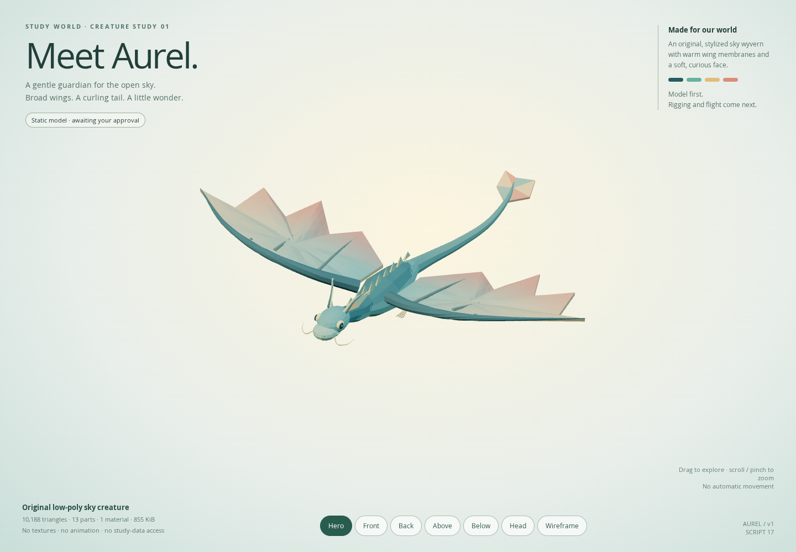

# Script 17 — Meet Aurel

> **Website update:** Aurel now flies in the live planner. No Blender steps are required to use it. See [flight integration](FLIGHT.md). The script instructions below remain optional source/editing workflows.

**Script 17: preserved static model study.** Aurel is an original gentle sky wyvern: teal body, broad scalloped sand/coral wings, soft swept head fins, friendly eyes, folded hind legs and a curling tail with a leaf rudder. Not a franchise creature replica.

**Update: the user approved this model in Blender. [Script 18 now supplies the rig and in-place animation](ANIMATION.md).** Script 17 remains an unchanged static model. The planner/island/villager assets and behaviour are unchanged; website flight paths are still a later step.



## One complete Blender script — run only this new file

Download **[17_aurel_sky_drake.py](../../assets/blender/scripts/17_aurel_sky_drake.py)**. No previous script, add-on, external model, image, internet connection or path editing is needed.

1. Put the downloaded file here (create the folders if missing):

   `C:\Users\kashif\Desktop\3d-world-study-planner\blender\scripts\17_aurel_sky_drake.py`

2. Open Blender. Choose **Scripting → Text → Open**, select `17_aurel_sky_drake.py`, then click **Run Script** (triangle icon).
3. Switch to **Layout** to inspect the model. Choose **Render → Render Image** for the prepared camera view. The model has no animation at this stage; playing the timeline will not flap the wings.
4. Save manually with **File → Save As**:

   `C:\Users\kashif\Desktop\3d-world-study-planner\blender\source\study_world_aurel_sky_drake_v1.blend`

   **If that file already exists, choose a fresh filename.** The script itself never saves, exports, deletes objects, downloads assets or overwrites your work. Every run creates a new scene; earlier scenes and Scripts 14–16 remain untouched.

### What you should see in Blender

- Scene: `Study World - Aurel Sky Drake v1` (Blender may append a numerical suffix on repeated runs).
- `SW17_Aurel_Model_EXPORT`: one root and 13 separate anatomical mesh parts. Named parts are preparation for a **later** rig, not an existing rig.
- `SW17_Presentation_DO_NOT_EXPORT`: camera and studio lights, separate from the creature.
- Embedded vertex colours, metre units, proper Z-up conversion. Available render engines are queried, preferring **`BLENDER_EEVEE`**, not the retired `BLENDER_EEVEE_NEXT` identifier.
- This is a separate model-studio scene, **not** an automatic merge into your earlier floating world.

**Checks:** Python compilation, complete embedded geometry/colour correspondence, new-scene/no-save/export/delete/network safety, and matching GLB rendering passed. **Actual Blender 5.2 execution/rendering is not verified in this environment.** If Blender reports an error, send its full message and line number before rerunning anything.

## Interactive review

The separate **Aurel** live preview runs on port **5176**, alongside the unchanged planner on **5173**. Its root now opens the Script 18 animation studio; this preserved static reviewer remains at `/design/sky-creature/review.html`. Stay in Arena's embedded preview; no external browser tab is needed. Drag to orbit, scroll/pinch to zoom, or use **Hero / Front / Back / Above / Below / Head / Wireframe**. Rendering only updates on input, resize or model load—no automatic rotation or continuous render loop.

Developers can restart the review with `npm run sky:review` and open its root URL. It now redirects to `/design/sky-creature/animation.html` on the same host; use `/design/sky-creature/review.html` for this static study. The model and manifest live beside this reviewer, **outside the deployed app's public models** until approval. `npm run build` builds the planner, not this development-only art studio. It never reads or writes planner storage.

## Model budget

| Property | Static model v1 |
| --- | --- |
| Asset | `models/aurel_sky_drake_v1.glb` |
| Size | 875,036 bytes (about 855 KiB) |
| Triangles | 10,188 |
| Mesh parts / draw calls in reviewer | 13 |
| Shared material | 1 opaque vertex-colour material |
| Textures / external resources | 0 |
| Closed, outward-wound geometric components | 50 across 13 parts |
| Approximate wingspan | 9.31 model units; final app scale is undecided |
| Armatures / clips | 0 / 0 — intentionally static |

All component surfaces are closed, consistently wound and have positive volume. Separate anatomical components can overlap where they attach; this is a game-art model, **not** a single watertight 3D-printing solid. No double-sided material is used to hide missing undersides. Thirteen parts are acceptable for inspection; rig batching, final flight population and mobile runtime budgets belong to the next stages. No physical-device FPS claims.

## Source and reproducible checks

- Geometry: `scripts/art/sky-drake.mjs`.
- Deterministic GLB + complete offline Python builder: `scripts/build-sky-creature.mjs`.
- File hash, budget, finite attributes, mirrored wings, closed surfaces, consistent winding and positive component volumes: `scripts/validate-sky-creature.mjs`.
- Python syntax/payload/safety and optional earlier-file hash preservation: `scripts/validate-sky-blender.py`.
- Actual Chromium/WebGL camera, wireframe, orbit/zoom/reset, mobile widths and demand-only render tests: `scripts/check-sky-creature.mjs`.

```sh
npm ci
npm --prefix design/model-review ci
npm run art:sky-creature
npm run test:sky-assets
npm run sky:review
# In a second terminal while the review server is running:
npm run test:sky
npm run build
npm test
```

Current results: **7 new creature browser groups, asset/Python checks, strict TypeScript/production build and all 112 existing unit tests passed**. Reviewer screenshots were inspected from the hero, top, underside and face views. Mobile controls tested at 320/390/430 × 844. Prior 84 app browser groups remain the historical villager-stage results, **not** reruns for this static art addition. Earlier 56 app-model/script files were hash-checked unchanged. Build reports only dependency annotation warnings, not failures.

Durable preview: `preview.png`; GLB hash/budget: `manifest.json`; scratch JSON reports and extra camera/mobile screenshots: ignored `.cache/sky-creature/`. No commits, pushes, app integration or study-logic changes are part of this step.
